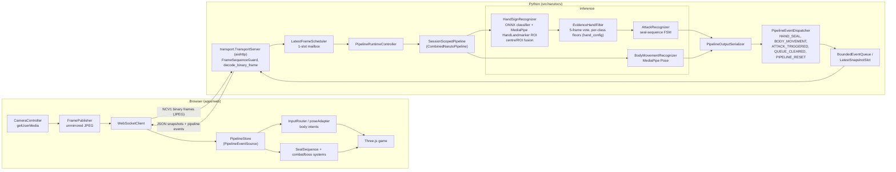
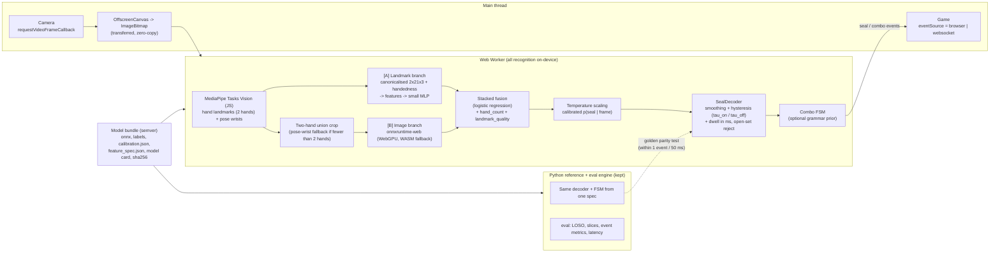

# Architecture

Two views: the system as it is implemented today (v0), and the target system from the [refinement plan](../03_refinement_execution_plan.md) (section 3.1 and Phase 5). Component names in the first diagram are real classes and files; the second is a design and none of it is implemented yet.

## 1. Current system (v0, implemented)

The browser owns the camera. Python does inference only and is a separate process.

Notes:

- **Wire protocol (NCV1).** A fixed big-endian header (`magic "NCV1"`, version, sequence, capture timestamp, width, height, payload length) followed by a JPEG of at most 2 MiB. Replies are JSON: `state_snapshot` (capped at 15 Hz) and `pipeline_event`, plus `ack` and typed `error` messages. Schemas live in `schemas/`. See `src/narutocv/transport/protocol.py`.
- **One controlling client.** A second connection is rejected, and the runtime is reset on disconnect so temporal state cannot leak between sessions.
- **Event source abstraction.** The game depends on `PipelineEventSource` (`apps/web/src/transport/eventSource.ts`), with a WebSocket implementation and a mock one. A future in-browser source plugs in here.
- **Known weaknesses** (see the [diagnosis](../03_refinement_execution_plan.md) and [ADR 0001](adr/0001-leakage-finding-and-subject-disjoint-evaluation.md)): the hand classifier is a whole-frame model trained on effectively one subject, and `hand_config.py` holds 13 hand-tuned confidence floors and 13 margin floors.

### Scheduler (`src/narutocv/inference/scheduler.py`)

`LatestFrameScheduler` decouples capture rate from inference rate with a **single-slot "latest frame wins" mailbox**:

- `submit(frame)` stores the frame in the one pending slot. If a frame is already pending it is overwritten and counted as dropped, so the queue never grows and latency cannot accumulate.
- One worker thread takes the pending frame, runs `runtime.process_frame(...)`, and publishes a `ScheduledResult` (with queue-wait, worker, and end-to-end timings) into a latest-result slot read by `poll_result()`. Counters (`submitted`, `processed`, `dropped`, `failed`, `superseded`) are exposed via `SchedulerStats`.
- `clear_pending()` discards a queued frame before a reset or calibration boundary.
- Precision note: the slot is guarded by a `threading.Condition`, so it is a mutex-protected mailbox, not a lock-free structure. Earlier project text calls it "lock-free"; the code does not support that wording.

## 2. Target system (planned, not implemented)

From plan section 3.1 (hand-centric hybrid), 3.3 (temporal decoder) and Phase 5 (in-browser). Component names are design names.

Design points:

- **Landmarks fix background/skin/lighting dependence; the image branch covers frames where interlocking breaks the landmarker.** The landmark spike shows which seals need which branch ([ADR 0002](adr/0002-landmark-image-hybrid-with-gated-fusion.md)).
- **One calibrated threshold and one hysteresis decoder** replace per-class constants ([ADR 0003](adr/0003-calibrated-probabilities-and-hysteresis-decoder.md)).
- **Browser-first, Python as the reference** ([ADR 0004](adr/0004-browser-first-inference.md)): the decoder and FSM are specified once and ported to TS, with a golden parity test in CI.
- **Privacy:** in browser mode no frames leave the device (planned).
