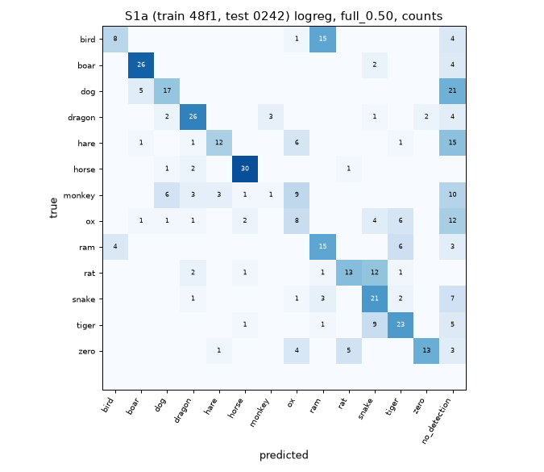

# Landmark spike v0 (Phase 2.2 proxy): can MediaPipe see both hands, and do landmarks generalize?

Status: proxy run on the EXISTING dataset (2,245 images, 13 classes), essentially one subject and two capture sessions. It is a de-risking signal, not the final answer. The real 3-subject recording in 2.2 still has to be done. All numbers below are produced by `scripts/spikes/landmark_audit.py`, `landmark_report.py` and `landmark_classifier.py` (raw outputs under `artifacts/`, not committed).

## Method

- HandLandmarker (`cv_model/models/hand_landmarker.task`, mediapipe 1.2.3 on Python 3.14), IMAGE mode, `num_hands=2`.
- Four configs on every image (8,980 runs, 0 unreadable files): full resolution at 0.50/0.50/0.50 and at the runtime's 0.45/0.45/0.45, and the 224x224 centre-square crop used in training at both settings.
- Session = UUID1 source node. Node `48f17fc25591` ("burst", 1,797 images, one date), node `0242ac1c0002` ("small", 437 images, includes the 86 original test images), 11 images with no UUID (excluded from S0/S1 splits).
- "Same-label %" = among images with 2 hands, both hands got the same handedness label. A real two-hand seal should be Left+Right, so this is a mislabel / hand-merging signal. (MediaPipe assumes a mirrored selfie image; the dataset appears unmirrored, but consistency is all that matters here.)
- Classifier features: per hand, image landmarks scaled back to pixel aspect, wrist at origin, scaled by wrist to middle-MCP length, left hands mirrored; two hand slots ordered Left then Right (tie-break by wrist x; a single hand goes in slot 0); wrist-to-wrist vector; mask (has hand A, has hand B, n hands). Zeros for a missing hand. Models: StandardScaler + LogisticRegression (C=1), StandardScaler + MLP (128,64), seed 0. Trained only on images with at least one hand. A 0-hand test image is predicted `no_detection` (wrong unless class is `zero`). Bootstrap: 1,000 resamples of the test set.

## 1. Detectability (primary config: full resolution, 0.50)

**all sources**

| class | n | 0 hands % | 1 hand % | 2 hands % | median handedness score | same-label % (of 2-hand) |
|---|---|---|---|---|---|---|
| bird | 192 | 2.1 | 9.9 | 88.0 | 0.980 | 0.6 (169) |
| boar | 182 | 20.9 | 62.6 | 16.5 | 0.907 | 20.0 (30) |
| dog | 273 | 7.7 | 54.9 | 37.4 | 0.981 | 2.9 (102) |
| dragon | 156 | 2.6 | 26.3 | 71.2 | 0.943 | 65.8 (111) |
| hare | 184 | 8.2 | 27.7 | 64.1 | 0.984 | 0.0 (118) |
| horse | 162 | 0.0 | 0.6 | 99.4 | 0.991 | 0.0 (161) |
| monkey | 141 | 7.8 | 14.2 | 78.0 | 0.992 | 0.9 (110) |
| ox | 176 | 7.4 | 80.1 | 12.5 | 0.877 | 9.1 (22) |
| ram | 122 | 2.5 | 94.3 | 3.3 | 0.974 | 0.0 (4) |
| rat | 130 | 0.0 | 49.2 | 50.8 | 0.944 | 1.5 (66) |
| snake | 151 | 5.3 | 35.8 | 58.9 | 0.984 | 3.4 (89) |
| tiger | 172 | 42.4 | 52.3 | 5.2 | 0.894 | 11.1 (9) |
| zero | 204 | 1.5 | 4.9 | 93.6 | 0.993 | 0.0 (191) |
| **all** | 2245 | 8.6 | 38.8 | 52.7 | 0.984 | 7.7 (1182) |

**source node 48f17fc25591 (burst session)**

| class | n | 0 hands % | 1 hand % | 2 hands % | median handedness score | same-label % (of 2-hand) |
|---|---|---|---|---|---|---|
| bird | 163 | 0.0 | 1.8 | 98.2 | 0.979 | 0.0 (160) |
| boar | 149 | 22.1 | 59.1 | 18.8 | 0.907 | 17.9 (28) |
| dog | 229 | 0.0 | 56.3 | 43.7 | 0.982 | 1.0 (100) |
| dragon | 117 | 0.0 | 13.7 | 86.3 | 0.921 | 71.3 (101) |
| hare | 148 | 0.0 | 21.6 | 78.4 | 0.982 | 0.0 (116) |
| horse | 127 | 0.0 | 0.0 | 100.0 | 0.991 | 0.0 (127) |
| monkey | 107 | 0.0 | 0.0 | 100.0 | 0.995 | 0.0 (107) |
| ox | 140 | 0.0 | 87.9 | 12.1 | 0.856 | 5.9 (17) |
| ram | 93 | 0.0 | 100.0 | 0.0 | 0.973 | - (0) |
| rat | 99 | 0.0 | 52.5 | 47.5 | 0.925 | 0.0 (47) |
| snake | 115 | 0.0 | 29.6 | 70.4 | 0.984 | 3.7 (81) |
| tiger | 132 | 50.8 | 48.5 | 0.8 | 0.874 | 100.0 (1) |
| zero | 178 | 0.0 | 0.0 | 100.0 | 0.993 | 0.0 (178) |
| **all** | 1797 | 5.6 | 35.3 | 59.2 | 0.984 | 7.8 (1063) |

**source node 0242ac1c0002 (4-day session, incl. original test set)**

| class | n | 0 hands % | 1 hand % | 2 hands % | median handedness score | same-label % (of 2-hand) |
|---|---|---|---|---|---|---|
| bird | 28 | 14.3 | 53.6 | 32.1 | 0.981 | 11.1 (9) |
| boar | 32 | 12.5 | 81.2 | 6.2 | 0.905 | 50.0 (2) |
| dog | 43 | 48.8 | 46.5 | 4.7 | 0.946 | 100.0 (2) |
| dragon | 38 | 10.5 | 63.2 | 26.3 | 0.978 | 10.0 (10) |
| hare | 36 | 41.7 | 52.8 | 5.6 | 0.993 | 0.0 (2) |
| horse | 34 | 0.0 | 2.9 | 97.1 | 0.992 | 0.0 (33) |
| monkey | 33 | 30.3 | 60.6 | 9.1 | 0.980 | 33.3 (3) |
| ox | 35 | 34.3 | 51.4 | 14.3 | 0.981 | 20.0 (5) |
| ram | 28 | 10.7 | 75.0 | 14.3 | 0.985 | 0.0 (4) |
| rat | 30 | 0.0 | 36.7 | 63.3 | 0.987 | 5.3 (19) |
| snake | 35 | 20.0 | 57.1 | 22.9 | 0.990 | 0.0 (8) |
| tiger | 39 | 12.8 | 66.7 | 20.5 | 0.969 | 0.0 (8) |
| zero | 26 | 11.5 | 38.5 | 50.0 | 0.976 | 0.0 (13) |
| **all** | 437 | 20.1 | 52.9 | 27.0 | 0.983 | 6.8 (118) |

Other configs, overall (all 2,245 images): full 0.45 gives 0 / 1 / 2 hands = 7.7 / 37.8 / 54.6 %; crop224 0.50 gives 14.3 / 44.9 / 40.8 %; crop224 0.45 gives 12.6 / 43.9 / 43.5 %. Lowering the threshold from 0.50 to 0.45 changes little (about +2 points of 2-hand detection).

**2-hand detection rate (%) by class and config**

| cls    |   crop224_0.45 |   crop224_0.50 |   full_0.45 |   full_0.50 |
|:-------|---------------:|---------------:|------------:|------------:|
| bird   |           47.4 |           38.5 |        89.6 |        88   |
| boar   |            6   |            3.8 |        20.9 |        16.5 |
| dog    |           28.9 |           25.6 |        43.2 |        37.4 |
| dragon |            7.7 |            7.7 |        66.7 |        71.2 |
| hare   |            2.7 |            1.6 |        69   |        64.1 |
| horse  |           97.5 |           96.9 |        99.4 |        99.4 |
| monkey |           75.9 |           75.2 |        78.7 |        78   |
| ox     |           73.9 |           71.6 |        14.2 |        12.5 |
| ram    |            2.5 |            1.6 |         4.9 |         3.3 |
| rat    |           87.7 |           85.4 |        52.3 |        50.8 |
| snake  |           51   |           45   |        62.9 |        58.9 |
| tiger  |            8.7 |            8.1 |         5.2 |         5.2 |
| zero   |           85.8 |           81.9 |        93.6 |        93.6 |

 Notable: the 224 centre crop is a mixed bag. It destroys hare (64 to 2 %), dragon (71 to 8 %) and boar (16 to 6 %), presumably because the centre square cuts hands off, but it greatly helps ox (12.5 to 71.6 %), rat (51 to 86 %) and bird is worse (88 to 38 %). The ox/rat gain suggests the landmarker's palm detector is scale sensitive and that full-frame hands are sometimes too large/close; that is a hypothesis, not tested here.

Overlays of the five lowest 2-hand classes (ram, tiger, ox, boar, dog), each with two failure frames and one best case, are in `docs/results/img/landmark_spike_overlay_<class>.jpg`. Crops are centred on the landmarks but the face is partly visible in some tiles.

## 2. Classifier preview (landmark-only, primary config full resolution 0.50)

Test sizes: S0 n=447, S1a n=437, S1b n=1,797. S1a/S1b train sets are small and imbalanced, so wide CIs are expected.

| split / model | subset | n test | accuracy [95% CI] | macro-F1 [95% CI] |
|---|---|---|---|---|
| S0_random_leaky/logreg (train n=1635) | all images | 447 | 0.886 [0.855, 0.917] | 0.912 [0.887, 0.936] |
| S0_random_leaky/logreg (train n=1635) | >=1 hand | 411 | 0.964 [0.944, 0.981] | 0.955 [0.929, 0.976] |
| S0_random_leaky/mlp (train n=1635) | all images | 447 | 0.904 [0.877, 0.928] | 0.935 [0.913, 0.953] |
| S0_random_leaky/mlp (train n=1635) | >=1 hand | 411 | 0.983 [0.971, 0.995] | 0.978 [0.960, 0.993] |
| S1a_train48f1_test0242/logreg (train n=1697) | all images | 437 | 0.487 [0.437, 0.533] | 0.520 [0.471, 0.561] |
| S1a_train48f1_test0242/logreg (train n=1697) | >=1 hand | 349 | 0.610 [0.559, 0.662] | 0.579 [0.524, 0.622] |
| S1a_train48f1_test0242/mlp (train n=1697) | all images | 437 | 0.487 [0.442, 0.538] | 0.530 [0.483, 0.572] |
| S1a_train48f1_test0242/mlp (train n=1697) | >=1 hand | 349 | 0.610 [0.559, 0.662] | 0.596 [0.544, 0.641] |
| S1b_train0242_test48f1/logreg (train n=349) | all images | 1797 | 0.761 [0.741, 0.780] | 0.773 [0.756, 0.789] |
| S1b_train0242_test48f1/logreg (train n=349) | >=1 hand | 1697 | 0.806 [0.788, 0.825] | 0.803 [0.786, 0.819] |
| S1b_train0242_test48f1/mlp (train n=349) | all images | 1797 | 0.829 [0.811, 0.846] | 0.825 [0.807, 0.840] |
| S1b_train0242_test48f1/mlp (train n=349) | >=1 hand | 1697 | 0.877 [0.863, 0.893] | 0.852 [0.835, 0.868] |

Per-class recall (all images, 0-hand = no_detection):

| class | S0_random_leaky/logreg | S0_random_leaky/mlp | S1a_train48f1_test0242/logreg | S1a_train48f1_test0242/mlp | S1b_train0242_test48f1/logreg | S1b_train0242_test48f1/mlp |
|---|---|---|---|---|---|---|
| bird | 0.97 | 0.97 | 0.29 | 0.46 | 1.00 | 1.00 |
| boar | 0.75 | 0.81 | 0.81 | 0.84 | 0.70 | 0.55 |
| dog | 0.96 | 0.96 | 0.40 | 0.37 | 0.37 | 0.80 |
| dragon | 0.94 | 0.90 | 0.68 | 0.74 | 0.89 | 0.89 |
| hare | 0.97 | 0.97 | 0.33 | 0.39 | 0.99 | 0.99 |
| horse | 1.00 | 1.00 | 0.88 | 0.76 | 1.00 | 1.00 |
| monkey | 0.75 | 0.86 | 0.03 | 0.03 | 1.00 | 1.00 |
| ox | 0.89 | 0.89 | 0.23 | 0.31 | 0.16 | 0.87 |
| ram | 0.96 | 0.96 | 0.54 | 0.39 | 1.00 | 1.00 |
| rat | 0.96 | 0.92 | 0.43 | 0.40 | 1.00 | 0.99 |
| snake | 0.90 | 0.97 | 0.60 | 0.54 | 0.81 | 0.27 |
| tiger | 0.41 | 0.50 | 0.59 | 0.56 | 0.35 | 0.40 |
| zero | 1.00 | 1.00 | 0.50 | 0.50 | 1.00 | 1.00 |

Same experiment on the 224 centre crop at 0.45 (accuracy only; full numbers in `artifacts/classifier_crop224_0.45.json`):

| split / model | all acc [95% CI] | >=1 hand acc [95% CI] |
|---|---|---|
| S0_random_leaky/logreg | 0.828 [0.794, 0.864] | 0.944 [0.921, 0.964] |
| S0_random_leaky/mlp | 0.843 [0.810, 0.877] | 0.962 [0.944, 0.980] |
| S1a_train48f1_test0242/logreg | 0.455 [0.407, 0.499] | 0.618 [0.565, 0.674] |
| S1a_train48f1_test0242/mlp | 0.444 [0.396, 0.490] | 0.602 [0.553, 0.655] |
| S1b_train0242_test48f1/logreg | 0.800 [0.780, 0.816] | 0.878 [0.862, 0.892] |
| S1b_train0242_test48f1/mlp | 0.716 [0.693, 0.736] | 0.786 [0.765, 0.805] |

### Confusion matrix, S1a (train 48f1, test 0242, logreg, rows true, columns predicted)

Main S1a confusions (counts from the matrix): bird to ram 15; rat to snake 12; tiger to snake 9; ox to tiger 6, to snake 4; monkey to ox 9 and 10 undetected; dog 21 undetected; hare 15 undetected, 6 to ox; zero to rat 5 and to ox 4; ram to bird 4 and tiger 6. Part of the S1a loss is plain no-detection (see the "all" vs ">=1 hand" gap: 0.487 vs 0.610).

## 3. What this shows

1. **Both hands are not reliably visible.** Only 52.7 % of images get 2 hands, 38.8 % get 1, 8.6 % get none. Per seal the picture is very uneven.
2. **Landmark-friendly (2 hands in at least about 85 % of frames, both sources for horse):** horse (99.4 %), zero (93.6 %), bird (88 %). In the second source only horse stays high (97 %); bird drops to 32 % and zero to 50 %, so even these are not safe across sessions.
3. **Middle:** monkey 78 %, dragon 71 %, hare 64 %, snake 59 %, rat 51 %. Dragon is a special warning: 65.8 % of its 2-hand detections have the same handedness label on both hands (71 % in the burst source), i.e. the two hands are being mislabelled or a hand is being detected twice. Dragon landmarks cannot use handedness for slot ordering.
4. **Need the image branch:** ram (3.3 % two hands, 94 % one hand, i.e. the interlocked fingers read as a single hand), tiger (5.2 % two hands, 42 % no hand at all), ox (12.5 %), boar (16.5 % two hands, 21 % none), dog (37 % two hands, 55 % one hand; 49 % none in the second source).
5. **Source shift is large.** Detection in the second source is worse for almost every class (overall 27 % two hands vs 59 %; 20 % zero hands vs 5.6 %). It is a different camera, framing and lighting, which is exactly the kind of shift the new data must cover.
6. **Landmark-only classification shows the leakage again.** S0 (random, leaky) accuracy is 0.886 (logreg) and 0.904 (MLP) on all images, but cross-session S1a drops to 0.487 for both, with S1b at 0.761 / 0.829. The model trained on the large burst session and tested on the small session is the realistic direction (the app will meet new people and rooms), and it is poor. Even among images where a hand is found, S1a accuracy is only 0.610. CIs for S1a do not overlap S0.
7. **Direct answer to "does it generalize better than the image model":** not measurable here. No cross-session image-model number was computed in this spike, so this comparison is open (Phase 1 baseline / E1 vs E3 should provide it). What can be said is that the landmark-only model is clearly not a standalone solution on this proxy: it loses about 40 points between S0 and S1a, mostly because of missing hands (about 20 % of the second source has none) and ram/rat/bird/hare/monkey/ox shifts. The S1a vs S1b asymmetry (training on 437 images generalizes to the burst session better than the reverse) reflects the burst session being near-duplicate frames of one setup, so the burst-trained model is effectively fitted to a few poses.
8. Per-class recall (S1a logreg): horse 0.88, boar 0.81, dragon 0.68, snake 0.60, tiger 0.59, ram 0.54, zero 0.50, rat 0.43, dog 0.40, hare 0.33, bird 0.29, ox 0.23, monkey 0.03. Single-hand shapes still carry signal for boar (0.81 recall with only 16 % two-hand detection) and ram (0.54), because the one detected hand has a distinctive silhouette, but ram is confused with bird (4) and tiger (6), and tiger with snake (9).

## 4. Recommendation

- **Do not let the landmark branch carry the model alone.** Treat it as a complementary branch with a learned gate (hand-count, handedness scores and landmark-quality are fusion inputs, as in 3.1) so that when fewer than 2 hands are returned the fusion leans on the image branch.
- **Seals by role (from this proxy):**
  - Landmark-led: horse; likely zero and bird if the new data keeps two-hand detection high (they did not in the second source).
  - Both branches: dragon (use landmarks but not handedness ordering; use order by x), monkey, hare, snake, rat. For rat vs ram the plan's thesis (finger topology) is untested here, since ram almost never yields two hands.
  - Image-led: **ram, tiger, ox, boar, dog.** Ram: landmarker sees one merged hand. Tiger: 42 % no hand. Boar and dog: mostly one hand. Single-hand landmarks still help for boar, so keep them as a weak input rather than discarding them.
  - **Dragon:** detected well enough but handedness is broken, and the 0/3 live failure in section 0 is not explained by detectability here. This points back to the seal-spec / data-mismatch cause.
  - **Rat:** 51 % two hands, but 12 of 30 test rat frames in S1a go to snake, so rat/snake needs the image branch even when landmarks exist.
- **Hand-dropout augmentation (landmark branch), starting rates to be tuned in E3/E4:** this proxy shows roughly 9 % zero hands, 39 % one hand, 53 % two hands (and 20 / 53 / 27 % in the second source). Train with per-sample branch-level corruption that mimics this: about 40 % of samples with one hand zeroed (random which one), about 10 to 15 % with both hands zeroed (landmark branch fully missing, image branch must carry), and add handedness-label flips at about 10 % so the model does not depend on the label. Weight toward the image-led classes (ram, tiger, ox, boar, dog) where missing hands are the norm. These are starting points, not tuned values.
- **Capture the 2.2 recordings to answer what this proxy cannot:** per-person, per-seal 2-hand rates, jitter, and the scale effect seen with the 224 crop (try several crop scales / a second pass at a zoomed ROI when 2 hands are not found, since ox and rat improved a lot with the crop while hare and dragon collapsed).

## Caveats

- Single-ish subject and two sources; the burst session (80 % of the images) is near-duplicate frames, so per-class rates are heavily correlated within a session. The 11 no-UUID images are excluded from S0/S1.
- Bootstrap CIs resample images, not sessions or people, so they understate uncertainty for generalization.
- Landmarker run on still images with no tracking; live video with tracking may behave differently.
- Not compared against the image model, no hyperparameter tuning, features are a first pass.
