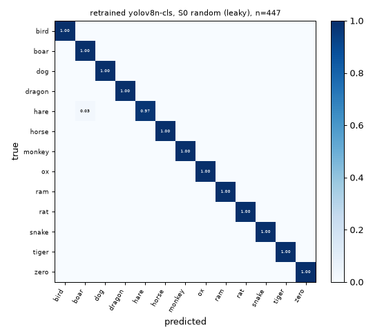
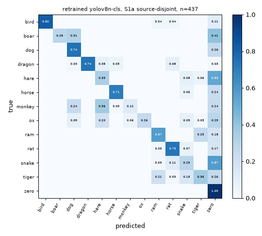

# v0 honest baseline

Generated by `scripts/baseline/make_report.py` from the JSON next to this file; every number below comes from a run executed for this report except the two figures labelled *claimed*.

## 1. Data provenance

| source_node | images | sessions | first (UTC) | last (UTC) | span (min) | orig. `test` imgs |
|---|---|---|---|---|---|---|
| 48f17fc25591 | 1797 | 1 | 2020-02-21 07:29:08 | 2020-02-21 07:50:11 | 21.0 | 0 |
| 0242ac1c0002 | 437 | 4 | 2020-02-03 18:16:00 | 2020-02-12 12:30:52 | 12614.9 | 86 |
| nouuid | 11 | 1 | - | - | - | 0 |

Raw image sizes (source, WxH): 0242ac1c0002 1280x720 x2; 0242ac1c0002 640x480 x435; 48f17fc25591 1280x720 x1797; nouuid 3264x1840 x11. All are centre-square-cropped to 224 before training.

`source_node` is the UUID1 node field, i.e. a **capture environment**, not a person or a device identity (`0242ac1c0002` is a Docker-style `02:42:ac:..` address). We do not know whether the same person appears in both sources. Session = node + UTC date. 8 raw images are pixel-identical (after the 224 crop) to another raw image.

Class x session counts (all 2,245 raw images):

| class | 0242ac1c0002_2020-02-03 | 0242ac1c0002_2020-02-04 | 0242ac1c0002_2020-02-08 | 0242ac1c0002_2020-02-12 | 48f17fc25591_2020-02-21 | nouuid | total |
|---|---|---|---|---|---|---|---|
| bird | 5 | 10 | 9 | 4 | 163 | 1 | 192 |
| boar | 5 | 8 | 9 | 10 | 149 | 1 | 182 |
| dog | 5 | 5 | 23 | 10 | 229 | 1 | 273 |
| dragon | 5 | 10 | 13 | 10 | 117 | 1 | 156 |
| hare | 6 | 10 | 10 | 10 | 148 | 0 | 184 |
| horse | 5 | 10 | 14 | 5 | 127 | 1 | 162 |
| monkey | 5 | 9 | 14 | 5 | 107 | 1 | 141 |
| ox | 4 | 10 | 14 | 7 | 140 | 1 | 176 |
| ram | 5 | 5 | 13 | 5 | 93 | 1 | 122 |
| rat | 5 | 10 | 10 | 5 | 99 | 1 | 130 |
| snake | 5 | 10 | 15 | 5 | 115 | 1 | 151 |
| tiger | 5 | 15 | 14 | 5 | 132 | 1 | 172 |
| zero | 6 | 0 | 15 | 5 | 178 | 0 | 204 |
| TOTAL | 66 | 112 | 173 | 86 | 1797 | 11 | 2245 |

## 2. Leakage audit of the old random split

Prepared dataset (`prepare_dataset.py`: random stratified 80/10/10 per frame, seed 42) mapped back to raw by exact 224-crop pixel hash ({'exact_pixels': 2245}). Train originals = prepared train files without `_aug_` (1796); 1064 augmented copies are excluded. pHash = 64-bit imagehash pHash of the centre-crop-224 image.

| prepared split | n | same-class near-dup in train originals: Hamming 0 | <= 2 | <= 6 | <= 10 | any-class <= 6 |
|---|---|---|---|---|---|---|
| val | 224 | 66.1% | 73.7% | 82.1% | 87.5% | 82.1% |
| test | 225 | 70.2% | 79.1% | 86.2% | 90.2% | 86.2% |

Session overlap: **100.0%** of prepared test images and 100.0% of val images come from a session that also has images in prepared train (test sessions: {'48f17fc25591_2020-02-21': 177, '0242ac1c0002_2020-02-08': 16, '0242ac1c0002_2020-02-12': 13, '0242ac1c0002_2020-02-03': 9, '0242ac1c0002_2020-02-04': 8, 'nouuid': 2}).

Near-duplicate clusters among the 2,245 raw images (connected components of the pHash Hamming graph):

| Hamming <= | clusters | singletons | images in multi-image clusters | largest cluster | clusters spanning >1 class |
|---|---|---|---|---|---|
| 2 | 505 | 426 | 1819 | 206 | 3 |
| 6 | 338 | 266 | 1979 | 481 | 7 |
| 10 | 260 | 177 | 2068 | 1619 | 8 |

The original raw train/test folders share no cluster at any threshold (0 spanning clusters at <= 6), but that split is irrelevant to the prepared dataset, which merged both and re-split by frame.

## 3. Results

Retrained = ultralytics `yolov8n-cls` fine-tuned from the same `yolov8n-cls.pt`, notebook approach-A hyper-parameters, **identical settings for every split** (epochs=50 max, patience=10; see Deviations). Val = 15% of the train portion (stratified, seeded, carved before offline class balancing to 220/class). The train column is `originals + balancing augmentations`. Macro-F1 is over classes with support > 0. CIs: stratified bootstrap, 1,000 resamples, seed 0, percentile 95%.

| split | train (orig+aug) | val | test n | accuracy [95% CI] | macro-F1 [95% CI] | ECE (15 bins) | worst 3 classes (F1, n) | epochs done / best | train wall |
|---|---|---|---|---|---|---|---|---|---|
| s0 | 1518+1342 | 269 | 447 | 0.998 [0.993, 1.000] | 0.998 [0.994, 1.000] | 0.002 | boar (0.99, 36), hare (0.99, 37), bird (1.00, 38) | 16 / 6 | 4.5 min |
| s1a | 1527+1333 | 270 | 437 | 0.524 [0.485, 0.565] | 0.537 [0.494, 0.578] | 0.099 | monkey (0.21, 33), zero (0.32, 26), snake (0.33, 35) | 12 / 2 | 3.1 min |
| s1b | 371+2489 | 66 | 1797 | 0.891 [0.883, 0.900] | 0.867 [0.857, 0.877] | 0.042 | tiger (0.13, 132), ram (0.60, 93), monkey (0.82, 107) | 21 / 11 | 5.0 min |
| s2_0242ac1c0002_2020-02-03 | 1842+1025 | 326 | 66 | 0.939 [0.879, 0.985] | 0.942 [0.883, 0.987] | 0.037 | tiger (0.83, 5), hare (0.83, 6), ox (0.89, 4) | 13 / 3 | 2.9 min |
| s2_0242ac1c0002_2020-02-04 | 1803+1064 | 319 | 112 | 0.688 [0.634, 0.741] | 0.635 [0.555, 0.701] | 0.162 | ox (0.18, 10), ram (0.29, 5), hare (0.33, 10) | 14 / 4 | 3.1 min |
| s2_0242ac1c0002_2020-02-08 | 1751+1109 | 310 | 173 | 0.688 [0.630, 0.751] | 0.712 [0.647, 0.768] | 0.132 | ox (0.44, 14), hare (0.47, 10), dog (0.59, 23) | 28 / 18 | 6.3 min |
| s2_0242ac1c0002_2020-02-12 | 1825+1038 | 323 | 86 | 0.884 [0.837, 0.930] | 0.859 [0.789, 0.921] | 0.069 | monkey (0.33, 5), ram (0.75, 5), bird (0.80, 4) | 14 / 4 | 25.1 min |

Split key: **s0** random frame-level (leaky); **s1a** train 48f17fc25591 -> test 0242ac1c0002; **s1b** train 0242ac1c0002 -> test 48f17fc25591 (this is also identical to leave-48f1-session-out, so S2 for that session is s1b); **s2_*** leave one session out, train on all other non-`nouuid` sessions. Held-out sessions can miss classes (see class x session table); macro-F1 uses classes present in that test set.

### Deployed `best_model_A.onnx` (CONTAMINATED: model trained on all sources)

Not an honest estimate. The deployed model was trained on a random 80% of frames from every source: 77.0% of the S0 test images and 77.3% of the S1a test images were literally in its training set (exact raw-image match to a prepared train original), and most of the remainder have near-duplicates there (section 2). `png224` = 224 PNGs from the training pipeline fed through the runtime tensor math; `rawcrop` = raw image, centre square, cv2 INTER_AREA 224 (runtime-style).

| set | pipeline | n | accuracy [95% CI] | macro-F1 [95% CI] | ECE |
|---|---|---|---|---|---|
| prepared_val | png224 | 224 | 0.996 [0.987, 1.000] | 0.996 [0.989, 1.000] | 0.010 |
| prepared_test | png224 | 225 | 0.987 [0.969, 1.000] | 0.984 [0.963, 1.000] | 0.012 |
| s0_test_png224 | png224 | 447 | 0.998 [0.993, 1.000] | 0.998 [0.994, 1.000] | 0.002 |
| s0_test_rawcrop | rawcrop | 447 | 0.998 [0.993, 1.000] | 0.998 [0.994, 1.000] | 0.002 |
| s1a_test_png224 | png224 | 437 | 0.991 [0.982, 0.998] | 0.989 [0.979, 0.997] | 0.013 |
| s1a_test_rawcrop | rawcrop | 437 | 0.991 [0.982, 0.998] | 0.989 [0.979, 0.997] | 0.017 |

Preprocessing self-check: on the prepared val/test PNGs this reproduction gives 99.55% / 98.67%, against the *claimed* 99.64% / 99.11% (taken from `03_refinement_execution_plan.md`, not re-measured by ultralytics here). The small gap is within a few images; the preprocessing and class order are right.

### Confusion matrices (row-normalised)

| S0 random (leaky) | S1a source-disjoint |
|---|---|
|  |  |

Reliability diagrams: `img/reliability_s0.png`, `img/reliability_s1a.png`.

## 4. Live-camera results (existing reports, not re-run)

3 attempts per seal on a webcam with the full runtime pipeline (thresholds, temporal filter). Source: `reports/hand-accuracy.json` (v1.0) and `reports/hand-v1.1-rerun-accuracy.json` (v1.1). `success` is as defined by those evaluators; predictions listed are the system's final prediction per attempt.

| seal | v1.0 success | v1.0 predictions | v1.1 success | v1.1 predictions |
|---|---|---|---|---|
| bird | 2/3 | bird, horse, bird | 3/3 | bird, bird, bird |
| boar | 0/3 | None, None, None | 3/3 | boar, boar, boar |
| dog | 0/3 | monkey, None, None | 1/3 | dog, monkey, hare |
| dragon | 0/3 | None, None, None | 0/3 | None, None, None |
| hare | 2/3 | None, hare, hare | 3/3 | hare, hare, hare |
| horse | 1/3 | None, None, horse | 2/3 | None, horse, horse |
| monkey | 3/3 | monkey, monkey, monkey | 3/3 | monkey, monkey, monkey |
| ox | 3/3 | ox, ox, ox | 3/3 | ox, ox, ox |
| ram | 0/3 | rat, rat, rat | 1/3 | ram, rat, rat |
| rat | 2/3 | None, rat, rat | 3/3 | rat, rat, rat |
| snake | 3/3 | snake, snake, snake | 3/3 | snake, snake, snake |
| tiger | 3/3 | tiger, tiger, tiger | 2/3 | rat, tiger, tiger |
| zero | 3/3 | zero, zero, zero | 3/3 | zero, zero, zero |
`None` = the system emitted no action event for that attempt (the raw per-frame model output may still have named a seal).

## 5. What this means

1. Same recipe, same data, only the split changes: macro-F1 0.998 (S0, random) vs 0.537 (S1a, train burst source -> test other source) and 0.867 (S1b, reverse). The ~99%+ figure measures memorisation of the room/session.
2. Cause: 86.2% of the old prepared test images have a same-class pHash near-duplicate (Hamming <= 6) among prepared train originals, and 100.0% come from a session also in train.
3. The deployed ONNX scores 0.991 accuracy on the S1a test images because it trained on those sources (77.3% of those images were in its training set; contaminated); the honestly retrained model gets 0.524 on the same images.
4. Failure shape is source-specific and not 'noise': S1a sends 113 of 437 images to `zero`; S1b sends 123 of 132 burst-source `tiger` images to `ram`. Leave-one-session-out macro-F1 over the four 0242ac1c0002 sessions ranges 0.635 (0242ac1c0002_2020-02-04) to 0.942 (0242ac1c0002_2020-02-03); per-session test sets are small, so CIs are wide.
5. Caveats: a single seed per split, ultralytics `auto` optimizer, and a leaky val set used for early stopping all make these numbers rough; the direction and size of the gap are the finding, not the third decimal.

S1 is **source/session-disjoint, not subject-disjoint**: we do not know whether the same person appears in both sources, so S1 numbers are still an optimistic bound on new-subject generalisation.

## 6. Deviations from the notebook recipe

- ultralytics 8.4.212, torch 2.15.0, Python 3.14.4; one Apple `mps` device instead of 2x T4 DDP; optimizer left on ultralytics `auto` (AdamW here); `seed=42`, `deterministic=False`, `plots=False`, `workers=4` (ultralytics reported 0 dataloader workers on MPS).
- Notebook ran epochs=50, patience=10 on the leaky random split; same values here for every split (the notebook text says ~50-80 epochs; the 80 was approach B).
- Offline balancing to 220/class re-implemented with a seeded RNG (`src/narutocv/data/augment.py`), same operations as `prepare_dataset.py`. For s1b/s2 on the burst source or small train portions this means many augmented copies per original.
- Early stopping uses a val set drawn from the *same sources/frames as train*, so val is leaky in every split, including s1/s2. Epochs completed differ per split because of that.
- Test predictions use ultralytics `predict` at imgsz=224 on the same 224 centre-crop PNGs.
- Wall times are on a shared machine (other jobs were running) and are indicative only; the longest (s2_..._2020-02-12) completed a similar number of epochs to the others in a several-times-longer wall time, which we attribute to machine contention (not investigated).
- Single seed per split; no seed-to-seed variance is estimated, only test-set bootstrap CIs.

## 7. Reproduce

```bash
uv venv --python 3.14 .venv
uv pip install --python .venv/bin/python torch torchvision ultralytics onnxruntime imagehash pandas pyarrow scikit-learn matplotlib pytest pillow opencv-python-headless
export RAW_ROOT='<path>/Pure Naruto Hand Sign Data'   # read-only raw data
export PREPARED_ROOT='<path>/cv_model/data/prepared_dataset'   # old leaky split
export PYTHONPATH=src
.venv/bin/python -m narutocv.data.manifest --raw-root "$RAW_ROOT"
.venv/bin/python -m narutocv.data.dedup --raw-root "$RAW_ROOT" --prepared "$PREPARED_ROOT"
.venv/bin/python scripts/baseline/build_splits.py --raw-root "$RAW_ROOT"
YOLO_OFFLINE=1 .venv/bin/python scripts/baseline/train_split.py s0 s1a s1b s2_0242ac1c0002_2020-02-03 s2_0242ac1c0002_2020-02-04 s2_0242ac1c0002_2020-02-08 s2_0242ac1c0002_2020-02-12
.venv/bin/python scripts/baseline/eval_onnx.py --raw-root "$RAW_ROOT" --prepared "$PREPARED_ROOT"
.venv/bin/python scripts/baseline/make_report.py --live-dir <path>/reports
.venv/bin/python -m pytest --import-mode=importlib tests
```
